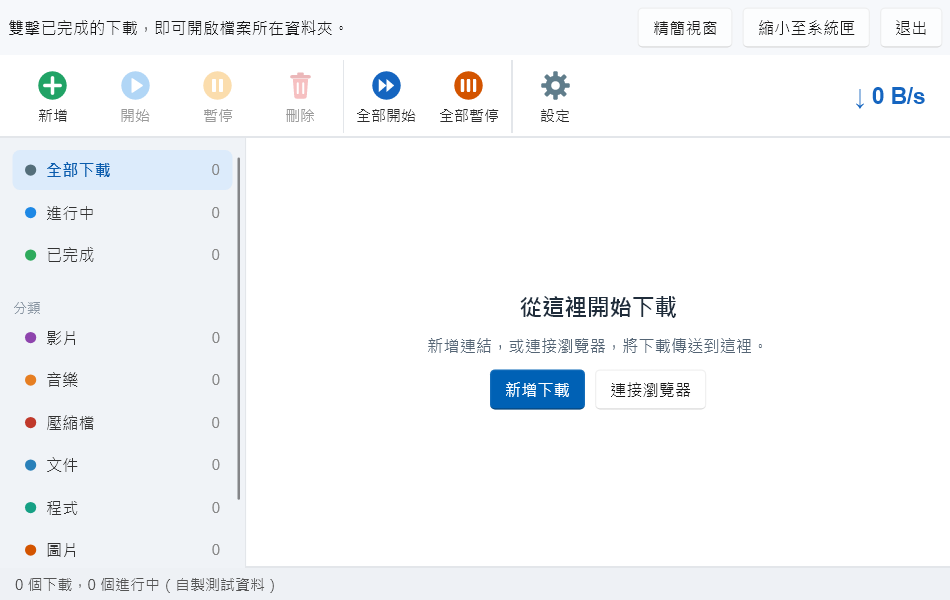

# Downloader

桌面控制：完成項目雙擊定位、Windows 系統匣、浮動精簡視窗。詳見 [繁中使用說明](docs/desktop-controls.zh-TW.md)。

[](https://github.com/stevenke1981/Downloader/actions/workflows/ci.yml)

**[繁體中文](#繁體中文) | [English](#english)**



---

## 繁體中文

Downloader 是用 Rust 寫的多連線下載加速／管理工具，介面用 Slint，支援 Windows、Linux、macOS。

### 功能
- **多連線分段下載**：用 HTTP Range 把檔案切成多段同時下載（每個下載最多 32 條連線，可設定）。先下完的連線會自動把最慢那段切一半接手，不會被單一條慢連線拖住。
- **續傳**：暫停或關掉程式後，進度會存起來，下次開啟會接著下載。會檢查 ETag / Last-Modified，伺服器上的檔案變了就從頭下載；伺服器不支援 Range 時自動改用單一連線。
- **下載佇列**：同時下載數上限、優先順序（低／一般／高）、失敗自動重試（指數退避）。
- **限速**：全域限速和每個下載各自的限速（token bucket）。
- **排程**：只在指定時段（例如 02:00–07:00）下載，跨午夜也可以。
- **代理伺服器**：HTTP、HTTPS、SOCKS5。
- **自動驗證完整性**（預設開啟，可在設定關閉）：下載完一定會檢查大小和每一段是否完整；接著在同一個遠端資料夾找校驗檔（`檔名.sha256/.sha512/.b2/.sha1/.md5`、`sha256sums.txt`、`SHA256SUMS`、`b2sums.txt`、`md5sums.txt`、`CHECKSUMS` 等，支援 GNU 和 BSD 格式），也會用伺服器的 `Digest`、`Repr-Digest`、`Content-MD5`、`x-goog-hash` 標頭；ETag 剛好是 MD5 時只當參考。支援 SHA-256、SHA-512、SHA-1、MD5、BLAKE2b-512。比對不符時自動重新下載一次，還是不符就標成「驗證失敗」。清單有「完整性」欄，詳細資料顯示演算法、預期值、實際值和來源。有 `.sig`/`.asc` 時會顯示「有簽章檔」，但目前不驗證 OpenPGP 簽章。也可以在新增下載時貼上雜湊值（依長度判斷演算法，BLAKE2b 請加 `b2:`）。
- **分類**：依副檔名自動分成影片、音樂、壓縮檔、文件、程式、圖片、其他，可選擇存到各分類的子資料夾。
- **介面**：工具列、側邊欄篩選（全部／進行中／已完成／分類）、下載清單（名稱、大小、進度、速度、剩餘時間、狀態）、詳細資料區（每一段的進度圖、連線數、限速、優先順序）。
- **剪貼簿監看**（可選）：複製下載連結時自動跳出新增視窗。
- **多國語言**：繁體中文、簡體中文、English、日本語、한국어、Español、Deutsch、Français，在設定裡切換立即生效。系統語言是中文時預設繁體中文（簡體中文系統預設簡體）。
- **命令列工具 `dlx`**：不需要介面的下載，可續傳。

### 瀏覽器擴充功能（Chrome / Brave / Edge）
`extension/` 是 Manifest V3 擴充功能，Chrome、Edge、Brave 都能用：
- 右鍵選單：用 Downloader 下載連結、圖片、影音、此網頁，以及「下載全部連結」。
- 自動攔截瀏覽器下載，交給 Downloader（會帶上網址、來源網頁和檔名）。
- 預設會把該網站的 Cookie 一併交給 Downloader（只經本機連線傳給 App、只存在記憶體、不寫入磁碟），需要登入才能下載的檔案也能接手；可在選項關閉。App 重新啟動後，這類下載的續傳可能需要重新從瀏覽器下載。
- 選項：開關攔截、最小檔案大小、只攔截／不攔截的副檔名、按住 Alt 點擊改用瀏覽器下載、連不上 Downloader 時改用瀏覽器下載。
- 介面支援和 App 相同的 8 種語言。

**從 App 安裝**：開啟 **設定 → 瀏覽器擴充功能**，選擇 Chrome、Brave 或 Edge。頁面提供本機連線元件的檢查／註冊、擴充功能資料夾位置、複製路徑，以及開啟所選瀏覽器擴充功能頁面的按鈕。依畫面引導開啟「開發人員模式」，再用「載入未封裝項目」選取該資料夾。詳見 [瀏覽器整合使用說明](docs/browser-setup.zh-TW.md)。

狀態只表示本機連線元件是否正確指向目前的 App；擴充功能仍需在各瀏覽器使用的個人資料中載入。

**手動安裝方式**（還沒上架 Chrome 線上應用程式商店）：
1. 下載 Release 裡的 `downloader-browser-extension.zip` 並解壓縮（Windows 安裝版已放在安裝目錄的 `extension` 資料夾）。
2. 打開 `chrome://extensions`（Brave 是 `brave://extensions`、Edge 是 `edge://extensions`），開啟「開發人員模式」。
3. 按「載入未封裝項目」，選擇解壓縮後的資料夾。擴充功能 ID 固定為 `dikofgcelgoincfekonbdlmodjehgaah`。
4. 註冊連線元件：Windows 安裝程式會自動做（可在安裝時取消勾選）；免安裝版、macOS、Linux 請執行一次 `downloader --register-browser`。移除用 `downloader --unregister-browser`，解除安裝時會自動移除。

運作方式：擴充功能透過 Native Messaging 呼叫 `downloader-host`，它再經由 127.0.0.1 的本機連線（附隨機 token）把下載交給執行中的 Downloader；App 沒開的話會自動啟動。

### 下載
到 [Releases](https://github.com/stevenke1981/Downloader/releases) 下載：
- Windows：`downloader-setup-windows-x64.exe`（安裝程式，繁中／英文）或 `downloader-windows-x64.zip`（免安裝）
- macOS：`downloader-macos-universal-app.zip`（Downloader.app，Intel 和 Apple 晶片都能用）
- Linux：`downloader-linux-x64.tar.gz`（需要 GTK3 才能開啟選擇資料夾的視窗）

程式沒有數位簽章：Windows 第一次執行可能出現 SmartScreen 警告，macOS 請按右鍵 →「打開」。

### 命令列 `dlx`
```
dlx https://example.com/file.iso -o ~/Downloads -c 16 --limit 5M --checksum <sha256>
```
按 Ctrl+C 中斷後，再執行同一個指令就會續傳。

### 尚未支援
- **FTP**：還不支援（`ftp://` 連結會被拒絕）。
- **BitTorrent / 磁力連結**：不支援。
- **系統匣圖示**：目前只有 Windows；其他平台可用精簡視窗。

### 建置
```
cargo build --release
cargo test --release
```
翻譯檔在 `gui/lang/`，由 `scripts/gen_po.py` 產生。

Windows 本機完整檢查（不使用 GitHub Actions）：`powershell -File scripts/verify-local.ps1`。包含格式、Clippy、release 建置／測試、擴充功能 Node 回歸測試與 CLI 啟動；加 `-BuildInstaller` 可一併建置 Windows 安裝程式，需要已安裝 Inno Setup。

---

## English

Downloader is a multi-connection download accelerator and manager written in Rust with a Slint GUI, for Windows, Linux and macOS.

### Features
- **Segmented multi-connection downloads** over HTTP/HTTPS using Range requests (up to 32 connections per download). Connections that finish early split the largest remaining segment, so one slow connection never holds up the download.
- **Resume across restarts**: segment state is persisted; ETag / Last-Modified are checked and the download restarts if the file changed. Servers without Range support fall back to a single connection.
- **Queue** with a max-concurrent limit, priorities, and retries with exponential backoff.
- **Speed limits**: global and per download (token bucket).
- **Scheduler**: only download inside a time window (e.g. 02:00–07:00, wraps midnight).
- **Proxy**: HTTP, HTTPS and SOCKS5.
- **Automatic integrity verification** (on by default): size and segment completeness are always checked; then checksum sidecars (`<file>.sha256/.sha512/.b2/.sha1/.md5`) and lists (`sha256sums.txt`, `SHA256SUMS`, `b2sums.txt`, `md5sums.txt`, `CHECKSUMS`, ...; GNU and BSD formats) in the same remote directory, checksum links the browser extension saw on the page, and `Digest` / `Repr-Digest` / `Content-MD5` / `x-goog-hash` headers are used (an MD5-looking ETag is advisory only). SHA-256, SHA-512, SHA-1, MD5 and BLAKE2b-512. A mismatch triggers one full re-download, then the download is marked "Verification failed". `.sig`/`.asc` signatures are detected and reported but not verified. `dlx --verify auto|off|<hash>`.
- **Categories** by file type (video, music, archives, documents, programs, images, other) with optional per-category sub-folders.
- **GUI**: toolbar, sidebar filters, download list (name, size, progress, speed, ETA, status), details pane with a per-segment progress map, add-download and settings dialogs.
- **Clipboard watching** (optional) opens the add dialog when you copy a link.
- **8 languages** switchable at runtime: 繁體中文, 简体中文, English, 日本語, 한국어, Español, Deutsch, Français. Traditional Chinese is the default on Chinese systems (Simplified on zh-CN/zh-SG).
- **`dlx` CLI** for headless, resumable downloads.

### Browser extension (Chrome / Brave / Edge)
`extension/` is a Manifest V3 extension for Chrome, Edge and Brave: context-menu items for links, images, video/audio, the page and "download all links"; automatic interception of browser downloads (the site's cookies are forwarded to the app by default so downloads that need a login work — sent only over the local connection, kept in memory, never written to disk; can be turned off); options for enabling interception, minimum size, include/exclude file types, Alt+click bypass and falling back to the browser when the app can't be reached. Localized in the same 8 languages.

**Install from the app**: open **Settings → Browser extension**, select Chrome, Brave or Edge, register/repair the native connector, then use the folder/path and browser-page buttons. Enable Developer mode in that browser, click **Load unpacked**, and select the displayed extension folder. Connector readiness checks the current installation's native host; it does not claim the extension is loaded in a browser profile.

**Manual install** (not on the Chrome Web Store): unzip `downloader-browser-extension.zip` from the release (the Windows installer also puts it in `<install dir>\extension`), open `chrome://extensions`, `brave://extensions` or `edge://extensions`, enable Developer mode, click "Load unpacked" and choose the folder. The extension ID is fixed: `dikofgcelgoincfekonbdlmodjehgaah`. The Windows installer registers the native messaging host; otherwise run `downloader --register-browser` once (`--unregister-browser` removes it).

On Windows, run `powershell -File scripts/verify-local.ps1` for local format/lint/release build/tests, extension regressions and CLI checks without GitHub Actions. Add `-BuildInstaller` if Inno Setup is installed.

How it works: the extension talks to `downloader-host` via native messaging; the host forwards to the running app over a token-protected 127.0.0.1 connection and starts the app if needed.

### Not yet supported
FTP and BitTorrent/magnet links are not supported yet. The system tray icon is Windows-only for now.

### License
MIT. This is an independent project; it is not affiliated with Free Download Manager, and all icons are original.
