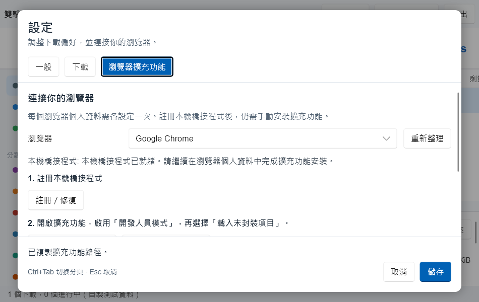

# 在設定中安裝瀏覽器擴充功能

Downloader 支援 Chrome、Brave、Edge。擴充功能尚未上架商店，透過瀏覽器的「載入未封裝項目」安裝。

1. 在 Downloader 開啟 **設定 → 瀏覽器擴充功能**，選擇要使用的瀏覽器。
2. 按 **註冊／修復**。這會將目前安裝位置的 `downloader-host` 註冊為目前使用者的 Native Messaging host。搬動免安裝版後，請重新修復。
3. 複製畫面上的擴充功能資料夾路徑，也可以開啟資料夾確認內容。
4. 按 **開啟擴充功能**，開啟該瀏覽器的「開發人員模式」，按 **載入未封裝項目**，選取步驟 3 的資料夾。
5. 在瀏覽器中確認 Downloader 已啟用。下載連結按右鍵，選擇用 Downloader 下載，以確認實際移交。需要登入的連結可以由擴充功能將 Cookie 透過本機連線傳給 App；Cookie 不寫入磁碟。

這些瀏覽器操作會立即執行，設定頁的「取消」只取消一般與下載設定的編輯。按鈕執行時會顯示處理狀態，錯誤會留在頁面上。

## 看懂狀態

- **連線元件就緒**：登錄位置、manifest、允許的擴充功能來源與 host 執行檔符合目前的安裝。這不代表已在某個瀏覽器個人資料中載入擴充功能。
- **需要註冊或修復**：尚未註冊、位置已變動、manifest 損壞或 host 不存在。確認 App 與 `downloader-host` 放在一起，再按修復。
- **找不到擴充功能資料夾**：確認使用完整安裝程式或解壓縮整份免安裝套件；不要只複製 App 的執行檔。
- **找不到瀏覽器**：先安裝該瀏覽器。也可以自行開啟 `chrome://extensions`、`brave://extensions` 或 `edge://extensions`。

使用多個瀏覽器或個人資料時，需要各自載入擴充功能。開發人員模式與載入操作由使用者在瀏覽器完成；App 不變更瀏覽器政策。

## 設定頁與鍵盤

一般、下載與瀏覽器各自有分頁；儲存／取消按鈕固定在底部，小視窗時只捲動設定內容。可用 Tab 巡覽控制項，Escape 關閉設定，Ctrl+Tab 切換分頁。

CLI 仍可使用：`downloader --register-browser`、`downloader --unregister-browser`。Windows 安裝程式保留註冊選項；macOS App、Windows／Linux 免安裝包均攜帶 `extension` 資料夾。
